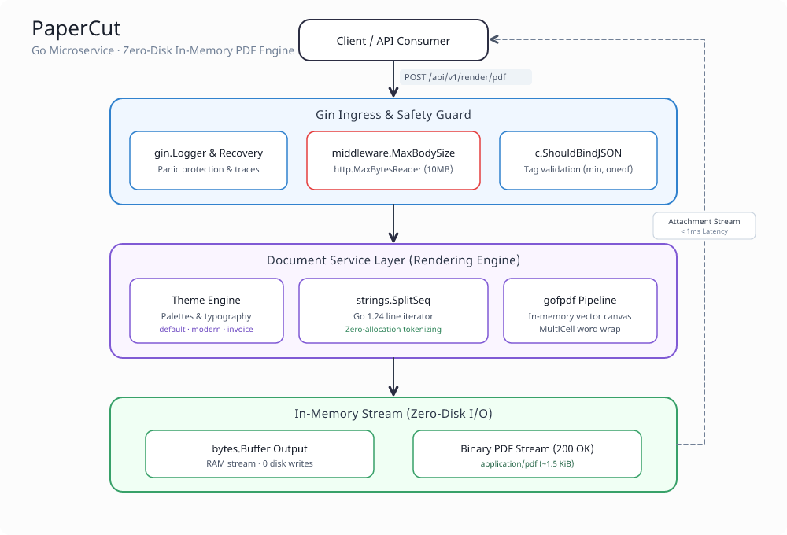

# PaperCut 📄✂️

[](https://golang.org)
[](https://gin-gonic.com/)
[](LICENSE)

An ultra-fast, headless document-rendering microservice written in Go. **PaperCut** converts raw Markdown documents into production-ready PDFs and streams them back in real time with **zero disk writes** and predictable in-memory execution.

---

## ⚡ Key Highlights

- **Zero-Disk I/O Pipeline:** All canvas construction, formatting, and PDF encoding occur directly inside Go memory buffers (`bytes.Buffer`). No temporary file cleanups, lock contentions, or disk thrashing under heavy traffic.
- **Reproducible Performance:** ~0.17 ms per document layout and PDF compilation on standard payloads, benchmarked with Go's native testing framework.
- **Go 1.24 Iterator Engine:** Uses `strings.SplitSeq` stream-based line iteration to eliminate full-slice heap allocations when parsing markdown blocks.
- **Memory Safety Middleware:** Native `http.MaxBytesReader` guard limits incoming payload streams to 10MB to prevent memory exhaustion and denial-of-service attempts.
- **Dynamic Theming:** Built-in palette and typography engine supporting `default`, `modern`, and `invoice` layouts with custom accents, margins, and divider rules.
- **Lean Container Footprint:** Packaged via a multi-stage Docker/Podman build into a non-root Alpine runtime under 35MB.

---

## 🏛️ System Architecture

<p align="center">
  
</p>

### Pipeline Flow

1. **Ingress & Memory Boundary:** Gin processes the incoming HTTP request through `middleware.MaxBodySize(10MB)`, wrapping `r.Body` with `http.MaxBytesReader` to block oversized payload sizes before JSON unmarshaling.
2. **Contract Validation:** `c.ShouldBindJSON` enforces presence, length limits, and supported presets (`oneof=default modern invoice`) via Go struct tags.
3. **Stream Iteration & Rendering:** The Document Service resolves theme palettes and ranges over lines using `strings.SplitSeq(markdown, "\n")`, formatting headers, bullet lists, and paragraphs directly onto an in-memory `gofpdf` canvas.
4. **Binary PDF Streaming:** The completed document is written to a `bytes.Buffer` and streamed straight back to the client (`Content-Type: application/pdf`) without touching the filesystem.

---

## 📊 Benchmarks

Microbenchmarks run directly against the rendering pipeline (`internal/service`) using Go's built-in benchmark harness (`go test -bench=. -benchmem`):

```text
goos: linux
goarch: amd64
pkg: github.com/yashG0/papercut/internal/service
cpu: AMD Ryzen 5 5600GT with Radeon Graphics
BenchmarkGeneratePDF_Small-12        7723        171498 ns/op      866748 B/op          430 allocs/op
BenchmarkGeneratePDF_Large-12         489       2277970 ns/op    11142393 B/op         9774 allocs/op
PASS
ok      github.com/yashG0/papercut/internal/service    2.442s
```

### Profile Breakdown

| Benchmark   | Document Size                 | Latency (`ns/op`) | Approx. Time | Memory Allocations | Heap Allocs       |
| :---------- | :---------------------------- | :---------------- | :----------- | :----------------- | :---------------- |
| **`Small`** | Standard 1-page document      | `171,498 ns`      | **~0.17 ms** | `846 KB`           | `430 allocs/op`   |
| **`Large`** | 50 repeated multi-line blocks | `2,277,970 ns`    | **~2.28 ms** | `10.6 MB`          | `9,774 allocs/op` |

To reproduce these benchmarks locally:

```bash
go test -bench=. -benchmem ./internal/service/
```

---

## 📁 Project Structure

Organized according to standard Go project conventions:

```text
papercut/
├── asserts/
│   └── architecture/
│       └── arch.png            # Architecture diagram
├── bin/
│   └── papercut                # Compiled local binary
├── cmd/
│   └── server/
│       └── main.go             # Application entry point & dependency injection
├── internal/
│   ├── handler/
│   │   ├── render.go           # Gin HTTP controller for PDF streaming
│   │   └── render_test.go      # httptest-based unit & integration tests
│   ├── middleware/
│   │   ├── limits.go           # Memory protection middleware (MaxBytesReader)
│   │   └── limits_test.go      # Payload ceiling boundary tests
│   ├── model/
│   │   └── document.go         # Request/response contracts & Gin binding tags
│   └── service/
│       ├── renderer.go         # Core Markdown-to-PDF rendering engine
│       ├── renderer_bench_test.go # Execution latency & allocation benchmarks
│       └── theme.go            # Typography, margins, and color definitions
├── Dockerfile                  # Multi-stage minimal runtime build
├── makefile                    # Build, run, test, and tidy automations
├── go.mod
├── go.sum
└── README.md
```

---

## 🚀 Getting Started

### Prerequisites

- [Go 1.24+](https://golang.org/dl/)
- [Docker](https://www.docker.com/) or [Podman](https://podman.io/) (optional)
- Make (optional)

### Local Development

1. **Clone the repository:**

   ```bash
   git clone https://github.com/yashG0/papercut.git
   cd papercut
   ```

2. **Run tests:**

   ```bash
   go test -v -race ./...
   ```

3. **Start the service:**
   ```bash
   go run ./cmd/server/main.go
   ```

The service boots on `http://localhost:8080`.

---

## 🐳 Container Deployment (Docker / Podman)

Build and run the lightweight container:

```bash
# Build image using Podman or Docker
podman build -t papercut:latest .

# Run container on port 8080
podman run -d -p 8080:8080 --name papercut-service localhost/papercut:latest

# Verify health
curl http://localhost:8080/healthz
```

---

## 📖 API Reference

### 1. Health Probe

Checks service liveness and readiness.

```http
GET /healthz
```

**Response (`200 OK`):**

```json
{
  "service": "papercut",
  "status": "healthy"
}
```

---

### 2. Render Markdown to PDF

Compiles markdown content and returns an attachment PDF stream.

```http
POST /api/v1/render/pdf
Content-Type: application/json
```

#### Request Schema:

| Field       | Type     | Required | Default     | Allowed Values                 | Description                    |
| :---------- | :------- | :------- | :---------- | :----------------------------- | :----------------------------- |
| `title`     | `string` | **Yes**  | —           | 1–100 characters               | Document heading and file name |
| `markdown`  | `string` | **Yes**  | —           | Non-empty string               | Raw Markdown text to render    |
| `theme`     | `string` | No       | `"default"` | `default`, `modern`, `invoice` | Visual style and color preset  |
| `page_size` | `string` | No       | `"A4"`      | `A4`, `Letter`                 | Page dimension format          |

#### Example Request:

```bash
curl -X POST http://localhost:8080/api/v1/render/pdf \
  -H "Content-Type: application/json" \
  -d '{
    "title": "Quarterly_Invoice_101",
    "theme": "invoice",
    "page_size": "A4",
    "markdown": "# Invoice #101\n## Client: ACME Corp\n- Cloud Architecture Consulting: $3,200\n- Automated PDF Service Delivery: $1,400\n\nTotal Due: $4,600.00\nPayment is due within 30 days."
  }' \
  --output invoice.pdf
```

**Response Headers:**

```http
HTTP/1.1 200 OK
Content-Type: application/pdf
Content-Disposition: attachment; filename="Quarterly_Invoice_101.pdf"
```

---

## 🧪 Testing

Unit and integration tests run in memory using `net/http/httptest`, verifying HTTP binding, edge-case rejection, and stream boundaries without binding real sockets:

```bash
go test -v -race ./...
```

---

## 📄 License

Distributed under the MIT License.
